# Nikon Firmware Tools (Nikon Hacker)

[English](#english-overview) | [中文说明](#项目概览)

[](#许可证与免责声明)
[](firmware%20decode/z-series/README.md)
[](Nikon-Patch-JS/README.md)

---

## 项目概览

**`nikon-firmware-tools`** 是源自 [Nikon Hacker](https://nikonhacker.com) 社区的综合开源资产库，专注于尼康相机固件的解包、逆向工程、仿真调试与功能补丁。

项目涵盖了从**早期数码单反（DSLR，如 D5100、D7000、D800、D750）**到**最新微单（Z 系列，如 Z6、Z8、Z9、Z f、Z50II、ZR 等 15 款机型）**十余年的逆向沉淀与最新突破，包含算法还原、汇编代码分析、操作系统/DSP/AI 模块剖析、QEMU 板级仿真以及浏览器端 WebAssembly 补丁工具。

---

## 核心板块导航

项目划分为四大核心板块：

```mermaid
graph TD
    Root["nikon-firmware-tools"]
    Root --> ZSeries["1. Z 系列微单逆向前沿<br>(firmware decode/z-series/)"]
    Root --> WebPatch["2. 现代固件补丁工具<br>(Nikon-Patch-JS / Nikon-Patch)"]
    Root --> DSLR["3. 经典单反逆向生态<br>(IDA 插件 / 脚本 / 内存映射)"]
    Root --> Protocols["4. 通信协议与硬件接口<br>(Remote SDK / PTP / 镜头协议)"]

    ZSeries --> Z1["15 款机型 / 148 份固件全历史对比"]
    ZSeries --> Z2["AArch64 / Linux / SOLID-OS / CEVA DSP 分析"]
    ZSeries --> Z3["Z8 官方固件 QEMU 10.2.4 板级引导与仿真"]
    ZSeries --> Z4["Open Gate 调研 / 诊断注入 / 传感器数据流"]

    WebPatch --> WP1["Nikon-Patch-JS (React + Vite + Wasm 在线打补丁)"]
    WebPatch --> WP2["Nikon-Patch (C# WinForms 本地解包与补丁工具)"]
    WebPatch --> WP3["Firmware Patch (MakePatch 差分补丁生成)"]

    DSLR --> D1["FR / Tx19a IDA Pro 处理器插件"]
    DSLR --> D2["IDA_files (D5100/D7000/D800 等 IDC 与符号表)"]
    DSLR --> D3["FirmwareNotes (ARMv7 / FR 内存映射)"]
    DSLR --> D4["Java Emulator & dfr (反汇编与固件模拟)"]

    Protocols --> P1["Remote SDK 2.0.0 (8,400+ 页 MTP 与配置索引)"]
    Protocols --> P2["PTP Tools (相机控制与内存转储)"]
    Protocols --> P3["USB Wireshark 补丁与机身-镜头通信协议"]
```



---

## 快速上手与使用者路径

请根据您的目标选择对应指引：

### 1. 摄影爱好者 / 补丁用户
- **在线使用补丁**：直接访问托管的 [在线补丁工具 (Online Patch Tool)](http://simeonpilgrim.com/nikon-patch/nikon-patch.html)。（支持解除视频 20 分钟录制时长限制、无损 HDMI 输出等）。
- **本地 Web 补丁前端开发与部署**：查看 [Nikon-Patch-JS 文档](Nikon-Patch-JS/README.md)（基于 Vite、React 与 Emscripten WebAssembly 构建）。
- **Windows 桌面端补丁工具**：查看 [Nikon-Patch LocalUI](Nikon-Patch/)。

### 2. Nikon Z 系列微单逆向研究员
- **进入微单主专区**：阅读 [Z 系列固件分析主目录](firmware%20decode/z-series/README.md)。
- **查阅机型时间表与封装对照**：查阅 [Z 系列相机发布时间表](firmware%20decode/z-series/RELEASE_TIMELINE.md)（15 款机型、EXPEED 6/7、旧三表 XOR 与 `0x260` 新封装分布）。
- **全历史 148 份固件比较与发现**：阅读 [全历史主要发现](firmware%20decode/z-series/analysis/all_history/FINDINGS.md) 与 [逐版差异总报告](firmware%20decode/z-series/analysis/all_history/REPORT.md)。
- **硬件仿真与引导复现**：查看 [Z8 官方固件 QEMU 适配指南](firmware%20decode/z-series/qemu/z8/README.md)。
- **前沿技术专题报告**：
  - [Z8 官方固件启动分析报告](firmware%20decode/z-series/analysis/z8_qemu_boot/REPORT.md)
  - [Z8 Open Gate 录制可行性调查](firmware%20decode/z-series/analysis/z8_open_gate/REPORT.md)
  - [Z8 主 CPU 与 DSP 调用接口及网络用途](firmware%20decode/z-series/analysis/z8_dsp_host/REPORT.md)
  - [Z8 诊断菜单与 UI 注入实验](firmware%20decode/z-series/analysis/z8_diagnostic_ui/REPORT.md)
  - [跨机型 AI 与 DSP 比较](firmware%20decode/z-series/analysis/ai_comparison/REPORT.md)
  - [Remote SDK 2.0.0 协议分析与属性索引](firmware%20decode/z-series/references/remote-sdk-2.0.0/README.md)

### 3. 经典单反（DSLR）逆向研究员
- **基址与内存映射**：阅读 [FirmwareNotes.md](FirmwareNotes/FirmwareNotes.md)（涵盖 D750, D780, D7100, D5500, D5300, D5200, D5100, D3300, D3200）。
- **IDA Pro 逆向插件**：
  - [Fujitsu FR 处理器插件 (FR IDA Plugin)](FR%20IDA%20Plugin/README.md)
  - [Toshiba TX19A 处理器插件 (Tx19a IDA Plugin)](Tx19a%20IDA%20Plugin/README.md)
- **机型 IDA IDC 脚本与符号表**：查看 [IDA_files 目录](IDA_files/)（包含 D3000、D3100、D5100、D600、D7000、D750、D800 等机型的中断、菜单、系统任务表与 PTP 脚本）。
- **固件反汇编与模拟**：查看 [Java Emulator 文档](Java/Emulator/README.md) 及 [dfr (Fujitsu FR 反汇编器)](dfr/)。

---

## 仓库目录索引

```text
nikon-firmware-tools/
├── README.md                      # 项目全局导览入口 (本文档)
├── docs/                          # 综合文档与知识库索引
│   └── CAMERA_MATRIX.md           # 全系列机型架构、处理器与固件逆向状态矩阵
│
├── firmware decode/               # 固件解码与深入逆向工程
│   ├── README.md                  # 解包工具总述
│   └── z-series/                  # 【核心】Nikon Z 系列微单全套逆向工程
│       ├── README.md              # Z 系列总导览与复现指南
│       ├── RELEASE_TIMELINE.md    # 15 款机型时间线与封装对照
│       ├── tools/                 # Python 解包、分析、测试与补丁生成工具集
│       ├── qemu/z8/               # Z8 AArch64 板级 QEMU 10.2.4 模拟器源码与配置
│       ├── references/            # 外部规范（Remote SDK 2.0.0 索引与对照）
│       └── analysis/              # 40+ 份单机型与专题深入逆向报告
│
├── Nikon-Patch-JS/                # 现代 WebAssembly 在线固件补丁工具 (Vite + React)
├── Nikon-Patch/                   # 经典 C# WinForms 本地固件补丁与解包应用 (LocalUI)
├── Firmware Patch/                # C# 固件差分补丁制作工具 (MakePatch)
│
├── FirmwareNotes/                 # 固件内存映射与硬件分析笔记
│   └── FirmwareNotes.md           # D 系列单反固件基址与内存段速查
├── IDA_files/                     # 针对各单反机型的 IDA Pro IDC 脚本、符号表与类定义
├── FR IDA Plugin/                 # Fujitsu FR 处理器 IDA Pro 逆向插件
├── Tx19a IDA Plugin/              # Toshiba TX19A MIPS 处理器 IDA Pro 逆向插件
├── GNU Patches/                   # FR80 GCC 3.4.5 / binutils 交叉编译补丁
├── Java/Emulator/                 # 基于 Java 的早期固件模拟器与 Dfr/Dtx 反汇编器
├── dfr/                           # C# 移植版 Fujitsu FR 反汇编器及校验脚本
├── softune/                       # Softune V6 编译器库与对象文件分析脚本
├── nfiles/                        # Nikon 专有文件 (.ncp, .nef, .nkld) 转储脚本
├── arch/                          # D90 内部系统架构描述 (YAML/gablock)
├── PTP Tools/                     # C# PTP 相机控制、寄存器转储与语言设置工具
├── USB/                           # Wireshark PTP 协议抓包解析补丁
└── wiki/                          # 历史 Wiki 资料与相机规格数据库
```

---

## 开发与构建环境要求

不同子项目根据技术栈有不同的构建环境要求：

| 子项目 | 主要语言 / 技术栈 | 依赖环境 | 构建指南 |
| :--- | :--- | :--- | :--- |
| **Z 系列分析工具** | Python (推荐 **`uv`**) | Python 3.10+, 推荐使用 `uv sync` 一键补全 `capstone`, `pycryptodome`, `unicorn` | 查看 [Python uv 指南](docs/PYTHON_UV_GUIDE.md) · [z-series README](firmware%20decode/z-series/README.md) |
| **Z8 QEMU 仿真器** | C / AArch64 汇编 | C 编译器, Ninja, GLib 开发库, Clang/LLD | 查看 [qemu/z8 README](firmware%20decode/z-series/qemu/z8/README.md) |
| **Web 补丁应用** | JavaScript / C / Wasm | Node.js 18+, Vite, Emscripten SDK | 查看 [Nikon-Patch-JS README](Nikon-Patch-JS/README.md) |
| **桌面补丁与解包** | C# (.NET WinForms) | Visual Studio 2017+ | 打开对应 `.sln` 工程编译 |
| **IDA 插件** | C++ | Visual Studio, IDA Pro SDK 6.x | 查看各插件目录内说明 |

---

## 历史社区与归档说明

- **Nikon Hacker 论坛**：[http://nikonhacker.com/index.php](http://nikonhacker.com/index.php) `[历史归档]`
- **Nikon Hacker 官方 Wiki**：[http://nikonhacker.com/wiki/Main_Page](http://nikonhacker.com/wiki/Main_Page) `[历史归档]`
- **在线补丁服务 (Simeon Pilgrim)**：[Online Patch Tool](http://simeonpilgrim.com/nikon-patch/nikon-patch.html) `[活跃]`
- **Google Code 归档项目**：如 `nikon-camera-control`、`nikon-firmware-tools` 早期版本均已迁移至本 Git 仓库。

---

## 许可证与免责声明

> [!CAUTION]
> **刷写或修改相机固件存在极高的风险，可能导致相机变砖或永久损坏。**
> 本项目所有分析成果、脚本、补丁和模拟器仅供技术研究、学习与逆向工程探索使用。作者与社区贡献者不对使用这些工具造成的任何设备损坏或数据丢失负责。

各子目录根据历史来源采用对应开源协议（详见各目录内的 `LICENSE` 或说明文件，如 BSD 3-Clause、GPL v2/v3、MIT 等）。

---

<a name="english-overview"></a>
## English Overview

**`nikon-firmware-tools`** is the primary repository of the **Nikon Hacker** community, dedicated to firmware unpacking, reverse engineering, emulation, and patching across both Nikon DSLRs and modern Z-series mirrorless cameras.

### Key Highlights
- **Nikon Z-Series Mirrorless Research**: Comprehensive reports and Python tooling covering 15 camera models and 148 historical firmware releases. Includes AArch64 Solid-OS/TOPPERS disassembly, Linux 4.14 kernel/rootfs extraction, CEVA DSP ELF analysis, Open Gate feasibility study, and a cycle-accurate AArch64 QEMU 10.2.4 board-level emulation for stock Z8 C 3.11 boot verification. (See [z-series README](firmware%20decode/z-series/README.md)).
- **WebAssembly Firmware Patcher**: Modern web frontend built with React, Vite, and Emscripten C-to-Wasm for client-side firmware patching (e.g., removing video time limits). (See [Nikon-Patch-JS](Nikon-Patch-JS/README.md)).
- **Classic DSLR Toolchain**: IDA Pro plugins for Fujitsu FR and Toshiba TX19A processors, model-specific IDC scripts, symbol tables, and memory mappings for D5100, D7000, D800, D750, etc.
- **Protocol & Hardware Reversing**: Nikon Remote SDK 2.0.0 documentation mapping (8,400+ pages indexed), PTP USB tools, and lens interface protocol documentation.
