# Nikon Firmware Tools (Nikon Hacker)

[](#license--disclaimer)
[](firmware%20decode/z-series/README.md)
[](Nikon-Patch-JS/README.md)
[](docs/PYTHON_UV_GUIDE.md)

---

## Project Overview

**`nikon-firmware-tools`** is the primary open-source asset repository of the [Nikon Hacker](https://nikonhacker.com) community, dedicated to firmware unpacking, reverse engineering, emulation, hardware research, and custom patching across Nikon cameras.

The project spans more than a decade of research, covering both **classic DSLRs (such as D5100, D7000, D800, D750)** and the **modern Z-series mirrorless ecosystem (15 camera models including Z6, Z8, Z9, Z f, Z50II, ZR, etc.)**. It includes container decoders, disassembly plugins, OS / DSP / neural network analyses, cycle-accurate QEMU board emulation, and in-browser WebAssembly patching tools.

---

## Core Modules & Navigation

The repository is organized into four core pillars:

```mermaid
graph TD
    Root["nikon-firmware-tools"]
    Root --> ZSeries["1. Z-Series Mirrorless Research<br>(firmware decode/z-series/)"]
    Root --> WebPatch["2. Firmware Patching Suite<br>(Nikon-Patch-JS / Nikon-Patch)"]
    Root --> DSLR["3. Classic DSLR Reverse Engineering<br>(IDA Plugins / Scripts / Memory Maps)"]
    Root --> Protocols["4. Communication Protocols & Hardware<br>(Remote SDK / PTP / Lens Protocol)"]

    ZSeries --> Z1["15 Models / 148 Releases Full History Comparison"]
    ZSeries --> Z2["AArch64 / Linux / SOLID-OS / CEVA DSP Analysis"]
    ZSeries --> Z3["Stock Z8 Firmware QEMU 10.2.4 Board Emulation"]
    ZSeries --> Z4["Open Gate Feasibility / Diagnostic Injection / Sensor Pipelines"]

    WebPatch --> WP1["Nikon-Patch-JS (React + Vite + Wasm Client Patcher)"]
    WebPatch --> WP2["Nikon-Patch (C# WinForms Local Unpacker & Patcher)"]
    WebPatch --> WP3["Firmware Patch (MakePatch Differential Tool)"]

    DSLR --> D1["FR & Tx19a IDA Pro Processor Plugins"]
    DSLR --> D2["IDA_files (IDC Scripts & Symbol Tables for D5100/D7000/D800)"]
    DSLR --> D3["FirmwareNotes (ARMv7 / FR Load Bases & Memory Maps)"]
    DSLR --> D4["Java Emulator & dfr (Disassemblers & Firmware Emulation)"]

    Protocols --> P1["Remote SDK 2.0.0 (8,400+ Pages MTP & Config Indices)"]
    Protocols --> P2["PTP Tools (Camera Control & RAM Dumping)"]
    Protocols --> P3["USB Wireshark Patches & Body-Lens Communication Protocol"]
```



---

## Quick Starts by Audience

Select your pathway according to your goals:

### 1. Photographers & Patch Users
- **Apply Patches Online**: Visit the hosted [Online Patch Tool](http://simeonpilgrim.com/nikon-patch/nikon-patch.html) (supports removing the 20-minute video limit, enabling clean HDMI output, bitrate tweaks, etc.).
- **Develop / Build the Web Patcher Locally**: See [Nikon-Patch-JS Documentation](Nikon-Patch-JS/README.md) (built with React, Vite, and Emscripten WebAssembly).
- **Windows Desktop Patcher**: Explore [Nikon-Patch LocalUI](Nikon-Patch/).

### 2. Nikon Z-Series Mirrorless Researchers
- **Main Research Hub**: Read the [Z-Series Firmware Analysis Hub](firmware%20decode/z-series/README.md).
- **Timeline & Container Types**: Consult the [Z-Series Camera Release Timeline](firmware%20decode/z-series/RELEASE_TIMELINE.md) (15 models, EXPEED 6/7, legacy 3-table XOR vs. `0x260` extended prefix distribution).
- **History Comparison (148 Firmware Releases)**: Read [Findings](firmware%20decode/z-series/analysis/all_history/FINDINGS.md) and [Version-by-Version Comparison](firmware%20decode/z-series/analysis/all_history/REPORT.md).
- **Hardware Emulation & Boot Verification**: Follow the [Z8 QEMU Board Emulation Guide](firmware%20decode/z-series/qemu/z8/README.md).
- **Topic Deep Dives**:
  - [Z8 Stock Boot & RTOS Startup Report](firmware%20decode/z-series/analysis/z8_qemu_boot/REPORT.md)
  - [Z8 Open Gate Video Recording Feasibility](firmware%20decode/z-series/analysis/z8_open_gate/REPORT.md)
  - [Z8 Host CPU & DSP Interface Analysis](firmware%20decode/z-series/analysis/z8_dsp_host/REPORT.md)
  - [Z8 Diagnostic Menu & UI Extension Experiment](firmware%20decode/z-series/analysis/z8_diagnostic_ui/REPORT.md)
  - [Cross-Model AI & DSP Comparison](firmware%20decode/z-series/analysis/ai_comparison/REPORT.md)
  - [Remote SDK 2.0.0 Reference Index](firmware%20decode/z-series/references/remote-sdk-2.0.0/README.md)

### 3. Classic DSLR Reverse Engineers
- **Memory Maps & Base Addresses**: See [FirmwareNotes.md](FirmwareNotes/FirmwareNotes.md) (covering D750, D780, D7100, D5500, D5300, D5200, D5100, D3300, D3200).
- **IDA Pro Disassembly Plugins**:
  - [Fujitsu FR Processor Plugin](FR%20IDA%20Plugin/README.md)
  - [Toshiba TX19A Processor Plugin](Tx19a%20IDA%20Plugin/README.md)
- **Model-Specific IDC Scripts & Symbols**: Browse [IDA_files/](IDA_files/) (including interrupt tables, menus, system tasks, and PTP scripts for D3000, D3100, D5100, D600, D7000, D750, D800).
- **Disassemblers & Emulators**: See [Java Emulator](Java/Emulator/README.md) and [dfr (Fujitsu FR Disassembler)](dfr/).

---

## Directory Index

```text
nikon-firmware-tools/
├── README.md                      # Primary repository landing guide (this document)
├── pyproject.toml                 # Modern PEP 621 / PEP 735 dependency & tool configuration
├── docs/                          # Comprehensive references and guides
│   ├── CAMERA_MATRIX.md           # Master architecture and reversing status matrix (1998-2026)
│   └── PYTHON_UV_GUIDE.md         # Guide for running Python tools with uv
│
├── firmware decode/               # Decoders and advanced reverse engineering
│   ├── README.md                  # Firmware unpacking overview
│   └── z-series/                  # [Core] Nikon Z-series mirrorless research
│       ├── README.md              # Z-series research hub and reproduction guide
│       ├── RELEASE_TIMELINE.md    # 15 models timeline and packaging comparison
│       ├── tools/                 # Python decoders, analyzers, test suites, and patchers
│       ├── qemu/z8/               # Z8 AArch64 board-level QEMU 10.2.4 emulator sources
│       ├── references/            # External references (Remote SDK 2.0.0 indices)
│       └── analysis/              # 37 model-specific and topic research reports
│
├── Nikon-Patch-JS/                # Modern WebAssembly browser firmware patcher (Vite + React)
├── Nikon-Patch/                   # Classic C# WinForms local patcher and unpacker (LocalUI)
├── Firmware Patch/                # C# differential firmware patch creator (MakePatch)
│
├── FirmwareNotes/                 # Firmware memory maps and hardware analysis notes
│   └── FirmwareNotes.md           # Load base and segment reference for DSLRs
├── IDA_files/                     # Model-specific IDA Pro IDC scripts, symbol tables, and classes
├── FR IDA Plugin/                 # Fujitsu FR processor plugin for IDA Pro
├── Tx19a IDA Plugin/              # Toshiba TX19A MIPS processor plugin for IDA Pro
├── GNU Patches/                   # FR80 GCC 3.4.5 / binutils cross-compilation patches
├── Java/Emulator/                 # Java-based firmware emulator and Dfr/Dtx disassemblers
├── dfr/                           # C# port of Fujitsu FR disassembler and test scripts
├── softune/                       # Softune V6 compiler library and object file dumping scripts
├── nfiles/                        # Nikon proprietary file (.ncp, .nef, .nkld) dump scripts
├── arch/                          # D90 system architecture description (YAML/gablock)
├── PTP Tools/                     # C# PTP camera control, register dump, and language fix tools
├── USB/                           # Wireshark PTP protocol capture and analysis patches
└── wiki/                          # Historical wiki data and camera hardware matrix
```

---

## Build & Runtime Environment

| Subproject | Primary Stack | Environment & Requirements | Guide |
| :--- | :--- | :--- | :--- |
| **Z-Series Tools** | Python (Recommended **`uv`**) | Python 3.10+, run `uv sync` to install `capstone`, `pycryptodome`, `unicorn` | [Python uv Guide](docs/PYTHON_UV_GUIDE.md) · [z-series README](firmware%20decode/z-series/README.md) |
| **Z8 QEMU Emulator** | C / AArch64 ASM | C Compiler, Ninja, GLib dev packages, Clang/LLD | [qemu/z8 README](firmware%20decode/z-series/qemu/z8/README.md) |
| **Web Patcher App** | JavaScript / C / Wasm | Node.js 18+, Vite, Emscripten SDK | [Nikon-Patch-JS README](Nikon-Patch-JS/README.md) |
| **Desktop Patcher** | C# (.NET WinForms) | Visual Studio 2017+ | Open `.sln` solution file |
| **IDA Plugins** | C++ | Visual Studio, IDA Pro SDK 6.x | See plugin directories |

---

## Community & Historical Archives

- **Nikon Hacker Forums**: [http://nikonhacker.com/index.php](http://nikonhacker.com/index.php) `[Archived]`
- **Nikon Hacker Wiki**: [http://nikonhacker.com/wiki/Main_Page](http://nikonhacker.com/wiki/Main_Page) `[Archived]`
- **Online Patch Service (Simeon Pilgrim)**: [Online Patch Tool](http://simeonpilgrim.com/nikon-patch/nikon-patch.html) `[Active]`
- **Google Code Archives**: Early projects (`nikon-camera-control`, `nikon-firmware-tools`) migrated here.

---

## License & Disclaimer

> [!CAUTION]
> **Modifying or flashing camera firmware carries significant risk and may permanently brick or damage your camera.**
> All analyses, scripts, patches, and emulators in this repository are provided strictly for educational and reverse engineering research. Neither the authors nor the contributors accept any liability for damaged hardware or lost data.

Individual directories maintain their original licenses (refer to `LICENSE` or headers in respective directories, e.g. BSD-3-Clause, GPL-2.0-or-later, MIT).
